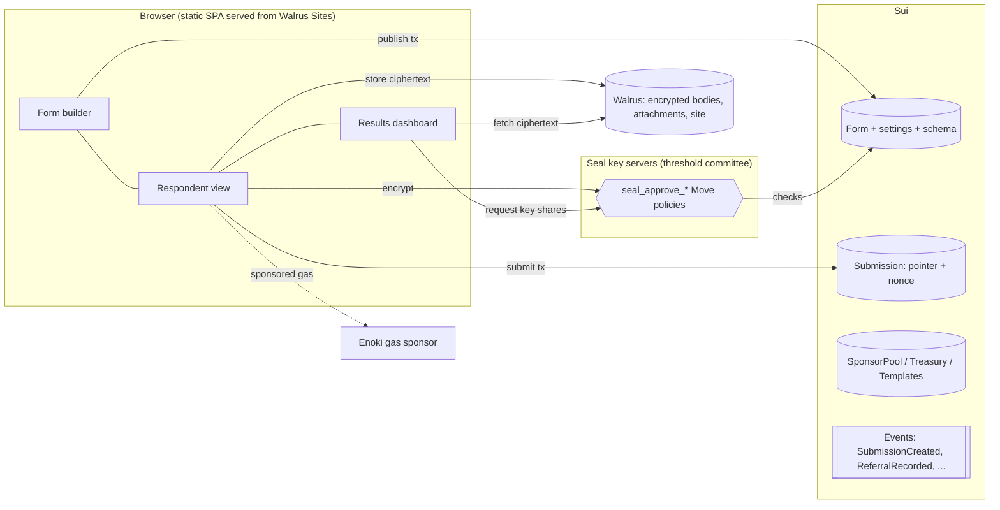
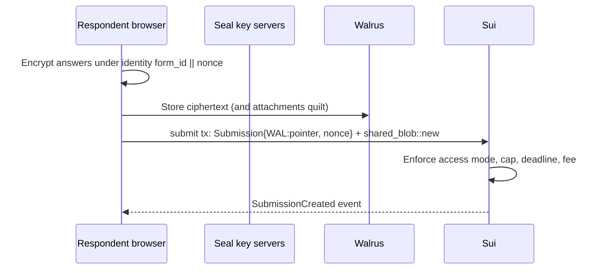

# WalForm Whitepaper

**Encrypted, on-chain forms on Sui, Walrus and Seal**

Version 1.0 · October 2026 · Live at [walform.wal.app](https://walform.wal.app)

---

## Abstract

Online forms collect some of the most sensitive data people share: identities, contact details,
health and financial answers, votes, applications. Today that data sits on a vendor's servers, in
plaintext to the vendor, under the vendor's terms, and a form can disappear when an account is
suspended or a company shuts down.

WalForm is a form builder in which the platform is not trusted with the data. Form definitions are
Sui objects. Every response is encrypted in the respondent's browser with Seal, a threshold
encryption network whose decryption rules are Move smart contracts, and the ciphertext is stored on
Walrus, a decentralized blob store. The application itself is a static site served from Walrus
Sites. The result is a form tool whose operator cannot read submissions, cannot alter them and
cannot take a form down, while respondents get a mainstream experience: Google sign-in, no wallet
funding, and no crypto jargon.

On top of that core, WalForm adds features that only make sense on a programmable ledger:
creator-funded storage sponsorship, storage that anyone can extend, verifiable referral links, paid
forms with on-chain treasuries and a template marketplace with enforced royalties. This paper
describes the system's design, its security and trust model, its economics and its roadmap.

---

## 1. The problem

| Concern | Conventional form tools (Google Forms, Typeform, Tally, Airtable) |
|---|---|
| **Confidentiality** | Responses are readable by the vendor and anyone who compromises it. "Encryption at rest" protects against stolen disks, not against the operator. |
| **Integrity** | Responses live in a database the vendor controls; there is no proof a submission wasn't edited, dropped or back-dated. |
| **Availability** | A form exists at the vendor's discretion: account bans, policy changes, outages and shutdowns take it offline. |
| **Ownership** | Data export is a feature, not a right. Moving or composing responses with other systems depends on the vendor's API. |
| **Attribution** | Measuring who brought whom (referrals) requires workarounds with hidden fields and prefilled URLs, and the counts are unverifiable. |

Existing "web3 forms" typically fix one of these: they encrypt but keep a centralized backend, or
put data on-chain in plaintext. None combine end-to-end encryption, decentralized storage, a
decentralized frontend and a mainstream respondent experience.

## 2. Design principles

1. **Data sovereignty over convenience.** Submissions are encrypted client-side before they leave the
   device. Decryption rights are defined by a public Move policy, not by an operator.
2. **Mainstream UX, not crypto UX.** A respondent should not need to own crypto or understand a
   blockchain. Google sign-in (zkLogin), sponsored gas and sponsored storage remove those steps.
3. **Honest decentralization.** We state exactly what is decentralized and what is a replaceable
   convenience layer (Section 10).
4. **Composable by default.** Forms, submissions, treasuries, templates and referrals are ordinary
   Sui objects and events that any other application can read and build on.
5. **Upgrade without breaking.** Contracts evolve through compatible upgrades only; every version is
   logged, and old clients keep working.

---

## 3. System architecture

### 3.1 Overview

Everything a user touches is either a Sui object, a Walrus blob, or a static file on Walrus Sites.
There is no application server holding data. The only server-side component is a thin gas-sponsor
function (Section 6.1), which never sees plaintext and can be removed without affecting data.

### 3.2 On-chain objects

| Object (Move module) | Holds | Owned by |
|---|---|---|
| `Form` (`form`) | Title, schema (≤ 100 KB, or a Seal ciphertext for private forms), settings: access mode, allowlist, token gate, fee, submission cap, deadline, open/closed | Shared; mutated only with the `FormOwnerCap` |
| `FormOwnerCap` (`form_owner_cap`) | The right to update, close or administer a form | Creator |
| `Allowlist` (`allowlist`) | Addresses allowed to submit to a private form | Shared |
| `Submission` (`submission`) | Form id, submitter, encrypted body (or a `WAL:` pointer to Walrus), attachment ids, 16-byte nonce, timestamp | Shared |
| `FormReviewers` (`reviewers`) | Co-reviewers who may decrypt responses | Shared |
| `FormTreasury` (`payment`) | Fees collected by a paid form | Shared; withdrawn by the creator |
| `FormTemplate`, `TemplateListing` (`template`) | Marketplace templates and their prices | Shared |
| Votes (`voting`) | Up/down votes on templates | Shared |
| `SponsorConfig`, `SponsorPool` (`sponsor_pool`) | Platform fee and price ceilings; a form's storage budget | Shared |
| `ReferralRecorded` event (`referral`) | Who submitted through whose link | Event log |

The `Form`'s mutable `submission_count` and per-form limits are enforced inside `submit`, so caps,
deadlines and closed forms cannot be bypassed by a custom client.

### 3.3 Storage layout

| Data | Location | Why |
|---|---|---|
| Form schema and settings | Inline in the `Form` object | Small (≤ 100 KB), always available, no storage fee beyond Sui storage |
| Private-form schema | Inline as Seal ciphertext | Questions themselves can be confidential |
| Submission body | Seal ciphertext on **Walrus**; the `Submission` keeps a short `WAL:<blob id>` pointer | Bodies can be large; Walrus is cheap and decentralized |
| File attachments | One Walrus **quilt** per submission, referenced inside the encrypted body | One storage reservation for N files; URLs stay confidential |
| Builder app, renderer, per-form sites | Walrus Sites | No origin server to take down |

Every submission's blobs are wrapped as `walrus::shared_blob::SharedBlob` in the same transaction
that creates the `Submission`. A SharedBlob can be funded and extended by anyone, so a creator can
keep all responses alive (Section 6.3) without the respondents' involvement. Submissions are stored
for 10 Walrus epochs by default (about 140 days on mainnet) and can be extended up to Walrus's
horizon of 53 epochs ahead.

### 3.4 Encryption with Seal

Seal is a threshold identity-based encryption network. A ciphertext is bound to an *identity*, and
key servers release decryption shares only if a Move function `seal_approve_*` accepts the request.

- **Identity layout.** `form id (32 bytes) || submission nonce (16 bytes)`, namespaced by the package's
  stable `originalPackageId`. Each submission has its own identity.
- **Who can decrypt a submission.** `seal_approve_read_submission` accepts the form owner or the
  original submitter; `seal_approve_read_submission_with_reviewers` additionally accepts any member of
  the form's `FormReviewers`. Nobody else, including WalForm, can obtain the key.
- **Private form schemas.** `seal_approve_read_form_schema` releases the schema key only to the owner
  and allowlisted addresses, so the questions of a private form stay confidential too.
- **Threshold.** Mainnet uses Mysten's decentralized committee of 8 key servers with a 5-of-8
  threshold (testnet: 3-of-5). No single key server can decrypt.
- **Session keys.** A reader signs one personal message per session; the resulting session key is
  reused for every decryption in that view, so reading 500 responses costs one wallet prompt.
- **Key-server rotation.** A ciphertext is bound to the servers it was encrypted under. When servers
  are retired, the client keeps a resolver that picks the matching configuration per ciphertext, so
  historical responses stay readable.

### 3.5 Frontend and hosting

The builder is a static single-page application (React, Vite) deployed to Walrus Sites and resolved
through SuiNS at `walform.wal.app`. It reads chain state over Sui **gRPC** (objects, balances,
execution) and a full-history **GraphQL** indexer (events and transaction history). There are no
private APIs.

Forms are delivered two ways:

- **Mode A** — the shared renderer at `walform.wal.app/f?formId=…`.
- **Mode B** — a per-form Walrus Site: a shared static shell plus a small site object pointing at the
  form, optionally linked to the creator's own SuiNS name (`brand.wal.app`). Deploying it costs only
  the creator's gas and storage; WalForm takes no fee.

---

## 4. Lifecycle

### 4.1 Publish

The creator designs the form in a drag-and-drop editor: 18 field types, multi-page flows,
validation, themes (fonts, palettes, radii, card/page layout), cover images, and optional AI-assisted
generation that runs client-side with the creator's own API key. Publishing is one transaction that
creates the `Form`, its `FormOwnerCap`, its `Allowlist` and its `FormReviewers`.

### 4.2 Submit

The respondent is always the transaction sender, whether gas and storage are self-paid or sponsored.

### 4.3 Read

The creator (or a reviewer) loads the Results dashboard: submission objects come from chain, their
ciphertexts from Walrus, and decryption keys from Seal after one session signature. Decryption
happens locally. The dashboard offers summary charts, per-question breakdowns, an individual
response table with tags, referral analytics and export to CSV, JSON, NDJSON and Markdown.

---

## 5. Access control

| Mode | Rule | Enforcement |
|---|---|---|
| **Public** | Anyone may submit | On-chain |
| **Private (allowlist)** | Only allowlisted addresses may submit; schema can be encrypted | On-chain (`submit` checks the `Allowlist`) and Seal (schema) |
| **Token-gated** | Respondent must hold a minimum balance of a given `Coin<T>` | Checked by the client today; on-chain enforcement is on the roadmap |
| **Paid** | Respondent pays a fixed SUI fee per submission | On-chain; fees accrue to the form's `FormTreasury`, withdrawable only by the creator. WalForm takes no cut of form fees. |

All modes can be combined with a submission cap and a closing time, both enforced in `submit`.

---

## 6. Zero-friction submissions

### 6.1 Gas sponsorship

Every WalForm transaction is built in the browser and signed by the user's wallet. Before
submitting, the client asks a gas sponsor (Enoki, fronted by a small Supabase edge function) to pay
the gas. The function only sponsors an allowlist of WalForm and Walrus Move calls, and only for the
requesting sender. If the sponsor is unavailable or declines, the wallet pays instead; the code path
is identical, so there is no failure mode in which a user is stuck.

### 6.2 Creator-funded storage pools

Walrus storage is paid in WAL. Asking every respondent to hold WAL is a non-starter, but paying
storage from a platform wallet would make WalForm the uploader of everyone's data. The
`sponsor_pool` module solves both:

- A creator opens a `SponsorPool` for a form and deposits WAL (and a little SUI for upload-relay
  tips). Anyone may top it up; only the creator may pause it or withdraw.
- When a respondent submits, the same transaction **borrows** exactly the WAL the upload needs from
  the pool, registers the blob with the respondent as the sender and owner, and **settles** with a
  receipt (a hot-potato value that must be consumed in the same transaction). The respondent is the
  uploader on Walruscan; the pool merely pays.
- **Guardrails** keep a pool from being drained: a ceiling on WAL per upload, on relay tip per
  upload and on uploads per address; a price ceiling (1.25× the live Walrus price at configuration
  time) so a price spike cannot empty a pool; settle-once receipts; uncertified blobs only; and the
  form's own access rules (an allowlist form's pool only sponsors allowlisted respondents).
- **Platform fee.** WalForm adds a 5% fee on storage it sponsors, configured in `SponsorConfig` and
  hard-capped at 20% in the contract.

Combined with gas sponsorship, a respondent can submit with zero SUI and zero WAL.

### 6.3 Extending storage

Because every submission's blobs are SharedBlobs, extension is a public operation: the creator (or
anyone, such as a DAO archiving a vote) can top up and extend all of a form's files in one
transaction from the Manage tab. Cost is `encoded units × storage price × epochs`, with no write fee.
Expired blobs cannot be revived, so the dashboard surfaces the earliest expiry.

---

## 7. Referral links

After submitting, a respondent receives a personal link that carries their `Submission` id. A new
respondent arriving through it submits via `referral::submit_and_share` (or the paid variant), which:

1. creates the `Submission` exactly as a normal submit would (all access rules apply);
2. checks that the referrer's `Submission` belongs to the same form and that the referrer is not the
   new respondent;
3. emits `ReferralRecorded { form_id, submission_id, submitter, referrer, referrer_submission_id, submitted_at_ms }`.

A referral can only be recorded while its `Submission` is being created, so referrals cannot be
added to old submissions or duplicated. Because the link is derived from a submission, only people
who actually took part can refer others.

Referrals are opt-in per form. Counts are by distinct people, the first valid link a browser opens
is credited for 30 days (first touch), and the creator sees a leaderboard with each referrer's
invitees, optionally published on the form page. Discovery scans only the form's own transactions,
so cost scales with the form, not with the network.

---

## 8. Template marketplace

Creators can publish any form as a `FormTemplate` and list it free or for a price.

- **Multi-buyer listings.** A `TemplateListing` keeps the template shared after each sale; buyers
  clone it (`clone_paid_and_share`), the clone count increments, and the creator is paid on every
  clone. (Sui Kiosk's purchase consumes the item, which suits NFTs but not reusable templates; the
  legacy one-of-one Kiosk path remains for early listings.)
- **Royalties.** A 10% platform royalty (minimum 0.05 SUI) is enforced by a `TransferPolicy` and paid
  to the `PlatformTreasury`.
- **Curation.** Templates carry on-chain up/down votes (`voting`).
- **Confidential templates.** A template's schema can be Seal-encrypted so that only its creator can read it before sale; buyers receive a fresh plaintext form when they clone.

---

## 9. Economics

WalForm has **no token**. Users pay network costs in SUI and WAL; WalForm earns from two explicit,
contract-enforced fees.

| Action | Who pays | Notes |
|---|---|---|
| Publish, update, close a form | Creator (gas, often sponsored) | Schema stored inline in Sui |
| Submit | Respondent is the sender; gas sponsored when possible | Paid forms: fee goes 100% to the creator's treasury |
| Store a submission on Walrus | Respondent, or the form's sponsor pool | Pool adds the 5% platform fee |
| Extend storage | Whoever extends (usually the creator) | Pure Walrus cost |
| Deploy a per-form Walrus Site | Creator | No WalForm fee |
| Buy a marketplace template | Buyer | Creator payout + 10% platform royalty |

Measured costs: a sponsored submission with one attachment (two blobs) stored for 2 epochs cost
the pool about 0.0016 WAL including the platform fee on testnet; extending a form's files by 10
epochs costs fractions of a WAL; a full site update of the 24 MB builder cost 0.01–0.09 WAL.

Revenue therefore scales with real usage — sponsored storage and template sales — rather than with
access to user data.

---

## 10. Security and trust model

### 10.1 What is decentralized

| Layer | Decentralized? | Notes |
|---|---|---|
| Submission confidentiality | Yes | Seal threshold encryption; Move policies decide who decrypts |
| Submission storage | Yes | Walrus |
| Form definitions, ownership, rules | Yes | Sui objects and Move code |
| Access control, fees, caps, deadlines | Yes | Enforced in `submit` |
| Referrals, sponsorship accounting, royalties | Yes | Move modules and events |
| Frontend | Yes | Static site on Walrus Sites, SuiNS name |
| Data reads | Partly | Public gRPC full nodes and a GraphQL indexer; anyone can run their own |
| Gas sponsorship | No | Enoki via an edge function — a convenience layer with no access to data; removable |
| Sign-in | User's choice | Self-custodial wallets, or zkLogin with Google |
| Seal key servers | Federated | A threshold committee operated by independent parties |

### 10.2 Threats and mitigations

- **A malicious or compromised operator** cannot read responses (no keys), forge them (respondents sign),
  delete them (Walrus and Sui), or change decryption rules (published Move code).
- **The gas sponsor** only pays gas for allowlisted calls by the requesting sender; it cannot move
  user funds, and if it misbehaves users fall back to self-paid gas.
- **Pool drain** is bounded by per-upload, per-tip and per-address limits, price ceilings and the
  hot-potato receipt that forces borrow and settle into one transaction.
- **Referral gaming.** The contract rejects self-referrals and referrers from other forms, and records
  referrals only at creation. A person with many wallets can still refer themselves; allowlist,
  token-gated and paid forms raise that cost, and counts are by distinct addresses.
- **Key-server collusion** would require a threshold of independent Seal operators.
- **Upgrade risk.** Contracts change only through compatible Sui upgrades: existing functions and
  struct layouts cannot change, the stable `originalPackageId` anchors Seal identities, and every
  version is recorded in a public package log.

### 10.3 Privacy notes

Submission contents are private; submission metadata is not. The submitter's address, timestamps,
the form a submission belongs to and, for forms that enable them, referral relationships are public
on-chain. Creators of sensitive forms should leave referrals off and can invite respondents to use
fresh wallets or zkLogin.

---

## 11. Deployments

| | Mainnet | Testnet |
|---|---|---|
| Original package (Seal namespace) | `0x0128bec074eff2c7ad03b52f45321c529958f75633d74668373e890d23fb64bb` | `0x2d8b918defc43b3b72afe63364f9b974c636b5820082d9a64b031e5e6d977289` |
| Current package | v4 `0x221ecc1e966e81225e1becc6fb720ba3a34612c6b5dc3b0c33ad589794330277` | v7 `0x506b81ee7b86fc937bdcd9d719c6ed6dfd8e4acea157191245a9267d9b666536` |
| `sponsor_pool` introduced in | v3 `0xeddb1e70fa8bc39c39afb2974f1335db66f08ff28054b8f6bc9a915bcaad7213` | v6 `0x3246afeaca7a3bd45c03c36061ca68e572f0544150740c3bd90402d13c02db43` |
| `referral` introduced in | v4 `0x221ecc1e966e81225e1becc6fb720ba3a34612c6b5dc3b0c33ad589794330277` | v7 `0x506b81ee7b86fc937bdcd9d719c6ed6dfd8e4acea157191245a9267d9b666536` |
| `SponsorConfig` (fee 5%) | `0x8af42c6f6b8ca07ceb09e406662bc29f632b08db31a9aa1a6b956dc4ac506262` | `0x58c9964e46620a73570bc45262071772b69361412cb6c419f64d6719c43acfc2` |
| Walrus Site (walform.wal.app) | `0x3e0573ec782ce73c50126e9e315473a09d8eef4dbcaa12ea27d8ac1a5b82f05e` | — |

The full version history is in [`apps/contracts/PACKAGES.md`](../apps/contracts/PACKAGES.md).

---

## 12. Roadmap

**Near term**

- On-chain token gating and NFT/capability gating; reputation gates based on past submissions.
- Multi-token paid forms (`FormTreasury<T>`), bounty forms with escrowed payouts, royalty splits.
- Encrypted analytics: aggregate statistics without revealing individual answers.
- A public indexer and API for forms, submissions and referrals; embeddable form widget.
- Referral rewards funded by creators, once sybil resistance is strong enough to make rewards safe.

**Longer term**

- **Forms as a Sui primitive** — any protocol embeds WalForm for governance input, grant
  applications or allowlists, composing directly with the objects and events described here.
- **Community-run infrastructure** — self-hosted gas sponsors and upload relays to remove the last
  convenience dependencies.
- **Verifiable results** — zero-knowledge proofs of survey aggregates, so a creator can prove an
  outcome without revealing responses.
- **Datasets as assets** — consented, encrypted response sets sold or licensed under on-chain terms.

---

## 13. Conclusion

WalForm shows that a form tool does not have to choose between privacy and usability. Encryption is
the default and enforced by public code; storage and hosting are decentralized; respondents can
take part with nothing but a Google account; and features that are awkward elsewhere — sponsored
storage, verifiable referrals, paid forms, a royalty-enforcing marketplace — fall out naturally from
building on Sui, Walrus and Seal. Every form is an object anyone can build on, and no one, including
us, holds the keys to its answers.

---

### Glossary

- **Sui** — a layer-1 blockchain with an object-centric data model and the Move language.
- **Walrus** — decentralized blob storage on Sui; storage is bought per epoch in WAL.
- **Walrus Sites** — static websites served from Walrus, addressed by a Sui object and SuiNS names.
- **Seal** — threshold identity-based encryption whose access rules are Move functions.
- **SharedBlob** — a Walrus blob wrapper that anyone can fund and extend.
- **zkLogin / Enoki** — sign-in with an OAuth account that derives a Sui address; Enoki also sponsors gas.
- **Quilt** — a single Walrus blob that bundles many small files.
- **Epoch** — Walrus's storage billing period (about 14 days on mainnet).

### Links

- App: <https://walform.wal.app>
- Source: <https://github.com/UyLeQuoc/sui-walform>
- Design notes: [`SPONSORSHIP.md`](SPONSORSHIP.md), [`REFERRALS.md`](REFERRALS.md), [`PRD.md`](PRD.md)
